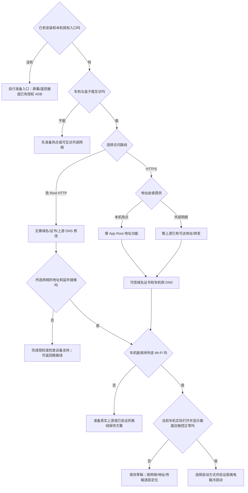

# 安卓首次设置：逐题分支规则

访问地址提示：安卓 HTTP 与 HTTPS 共用网页端口，默认 18743，自定义值以 App 显示为准。每次指引用户输入或打开地址，都明确提醒“请保留完整的 `http://` 或 `https://` 前缀，不要省略或替换”。复制和二维码须包含协议前缀。管理页面始终用 HTTP，不依赖证书或 HTTP 画面开关；RTC/JPEG 回退不更换端口。旧默认 8080/8081 升级为 18743；旧自定义 HTTP 端口保留为统一端口。

这是原生向导、README、用户说明和安装 Skill 的共同规则，对应 `SetupGuide` / `SetupActivity`。一次问一个问题，答案决定下一题。以本地 11.04 设置候选为准：已接入 HTTP／WebRTC／JPEG 与免 Root 地址实现；代码缺口与修复见支持矩阵，不把本地候选写成所有 ROM／热点／实车已经通过。实际安装版本须先核对。

## 从哪里开始

已经能打开 App → Q1。否则只检查现有入口：有屏幕/遥控器可安装并打开；App 已启动且已在可互访局域网，可用实际 HTTP 管理地址的 `/manage`；已有授权 ADB 可辅助安装/检查。三者都没有时，缺的是安装、启动和系统授权的入口，先自行准备。网络尚未连接时，不能承诺远程网页初设。

只说明需要什么能力及替代方案，**不指导刷机、解锁、获得 ADB、获得 Root、修改 su 或系统启动校验**。ADB 不是普通用户的必选项，ADB root 也不等于 App Root。网页配置不能代替 Android USB/VPN/蓝牙/Root 的系统确认。

## 一题怎样带出下一题

Q 编号用于查文档，界面只显示当前路径进度。缺条件时就地解释“缺什么 → 影响什么 → 可换什么”，允许返回/保存草稿，不静默切换方案。

| 题 | 何时出现 | 答案决定什么；不满足怎么办 |
|---|---|---|
| Q1 手机还是盒子？ | 所有人 | 手机固定无线；盒子可有线/无线/自动，同时决定布局、称呼和前台启动方式；不推断 Root/热点权限 → Q2 |
| Q2 普通浏览器还是特斯拉？ | 所有人 | 普通路线稍后跳过专用地址/联网保持；特斯拉增加这些条件 → Q3 |
| Q3 车机连哪个网络？ | 所有人 | 本机热点、外部网络、普通车机自己的热点。安卓手机与特斯拉当前不提供车机热点路径 → 外部网络问 Q3a，其余 Q4 |
| Q3a 谁开外部网络？ | 外部网络 | 路由器/随身 Wi-Fi/另一台手机 → Q4；同一部 CarPlay iPhone → 仅盒子可继续，Q6 使用有线；安卓手机提示更换网络来源，不允许继续此组合 |
| Q4 车机与接收端能互访吗？ | 包括纯有线 | 准备本机热点或无客户端隔离的外部网络 → 特斯拉 Q5，普通 Q6。没有网络先准备或换方案；USB 不代替车机的局域网 |
| Q5 选 HTTP 还是 HTTPS？ | 特斯拉 | **HTTP（实验性功能）**：不要求 Root、域名或证书；本机热点需 VPN 地址验证，外部网络使用实际 LAN 地址。优先 WebRTC，连接失败时改用 JPEG，实际效果需在车机验证。**HTTPS 本机热点**：需 App Root；**HTTPS 外部网络**：需上游已提供车机可访问的地址或转发。未准备好可保存草稿 → Q6 |
| Q6 iPhone 怎样连接？ | 所有人 | 手机仅无线：需经典蓝牙与合适局域网，缺蓝牙不能改选有线。盒子自动检测硬件，有线需 USB Host 和数据线，不依赖蓝牙；无蓝牙仍可有线/仅有线的自动模式。关闭、未授权不当作无硬件。车机热点/同一 iPhone 热点当前仅盒子可选有线。缺硬件/组合不支持说明原因 → Q7 |
| Q7 接收端怎样上网？ | 所有人 | 已有上游、通过数据线使用 iPhone 网络、仅局域网。使用 iPhone 网络需 USB Host，可能使用 iPhone 流量；手机独立选项默认关闭，旧有线配置不自动开启；无外网也可本地传画面 → 适用时 Q8，否则 Q9/Q10 |
| Q8 本机 USB/VPN 授权 | 盒子有线/自动，或用户主动选择无线 CarPlay 同时通过数据线使用 iPhone 网络 | 正常系统授权页；拒绝保留等待。盒子有线传输也依赖 VPN，不能说拒绝只影响使用 iPhone 网络。使用 iPhone 网络关闭仍可有线 CarPlay |
| Q9 车机怎样保持 Wi-Fi？ | 特斯拉两种方式都问 | 车机连接该 Wi-Fi 后有真实互联网；HTTPS 本机热点可选 App Root 离线检查；或 HTTP/外部网络已实测可以保持离线连接。本机热点且 Q7 选择不上网时，不应同时声明该热点提供互联网。外部网络的车机联网能力单独确认。缺条件可返回准备网络 → Q10 |
| Q10 用哪种 HTTPS 证书？ | 普通浏览器或特斯拉 HTTPS；HTTP 跳过 | 自己的域名与可信证书 → Q11；普通浏览器确认允许本地证书 → Q12。特斯拉不提供跳过警告作为可交付方案 |
| Q11 谁解析域名？ | HTTPS 域名方式 | 车机可查询已配置的公共 DNS、本机热点 Root DNS、或外部网络本地 DNS。公共记录须指向车机可以访问的接收端地址。接收端 Q7 的不上网选择只在本机热点路径限制公共解析，不据此否定外部网络的车机解析能力；特斯拉还需 Q9 确认车机联网。不能依赖旧缓存。缺解析先准备或返回 → Q12 |
| Q12 无线使用哪个 Wi-Fi？ | 仅实际无线链路 | 外部网络先选“使用当前 Wi-Fi / 其他 Wi-Fi”。能读取当前名称时预填；仅复用同名网络已保存的密码，否则用户填写。建议 5 GHz Wi-Fi。设置保存一次，邀请前检查实际网络；不一致时停止邀请并提示修改。应用自动热点自动获取；两套参数分别保存，不代替系统入网。纯有线跳过但 Q4 仍必需 → Q13 |
| Q13 导入身份 | 所有人 | 本软件不附带 CarPlay 身份，请自行导入。缺身份不能完成会话 → Q14 |
| Q14 声音从哪里出？ | 所有人 | 保存期望策略，实际出口另听音；特斯拉音频声明与行车限制仍待联合处理 → HTTP 去 Q14a，其余 Q15 |
| Q14a 实际 HTTP 显示画面了吗？ | 特斯拉 HTTP | 应用本次选择 → 按网络分支授权并启用入口 → 需要无线时添加 iPhone → 车机打开完整 HTTP 地址。只有当前本机入口就绪、配置相符，才允许确认真实画面/触控；打不开保留草稿或换路线 |
| Q15 每次怎样启动？ | 所有人 | 手动：不启用 App 开机启动；自动：启用开机启动，但热点恢复、ROM 后台限制、首次解锁仍需真断电验 → Q16 |
| Q16 总结 | 所有人 | 显示拓扑、iPhone 链路、上网来源、访问路线、保持与启动方式。重查所有可见答案/身份/权限/运行状态；先完成缺失功能页再结束，不能用“保存成功”冒充实车通过 |

返回改车型、拓扑、来源、访问路线等会使依赖确认失效；保留 Wi-Fi 草稿及明确偏好。HTTP 验证与本次服务、地址和配置关联，重启服务/换地址/改网络/恢复向导后重新确认。USB、导入身份、启用入口等功能页即时生效，草稿不是撤销已执行操作。

## 特斯拉路线图

HTTP 的“免 Root”指这一条地址/显示路线，不表示无需局域网、热点保持或设备兼容；本机热点的 VPN 地址另需正常系统授权。WebRTC 视频优先、连接失败时改用 JPEG 图片，解决的是浏览器接收画面的问题，不能绕过客户端隔离或建立缺失的物理网络。普通 iPhone/安卓热点使用盒子的实际 LAN 地址，不要求修改 DNS；它们不会自动把 `100.96.0.1` 转给盒子。车机不接受 LAN HTTP 地址时该组合不成立，不能仅建议再开一次 VPN。

HTTPS 则仍需地址、可信证书、解析三者同时满足。`100.96.0.1` 是项目使用的兼容地址，不是公网，不是把路由器管理 IP 改成它就完成。手机的运营商出口也不自动转发到盒子。车机能查询公共 DNS 且域名记录已指向可访问的接收端地址时，不必一律修改上游 DNS；不能查询时要有本地解析。HTTP 路线不需要 DNS，但不会自动让车机接受无互联网热点。

## 哪些能力在哪条路上需要

| 能力 / 设置 | 何时需要 | 谁完成；缺少后的选择 |
|---|---|---|
| 安装与本机交互入口 | 首次安装、系统授权 | 用户已有屏幕/遥控器/授权 ADB；都没有先自行准备。仅网络管理不能越过系统授权 |
| ADB | 可选维护手段 | 已有授权才用，明确目标；不要求普通用户先开 ADB，不教获取 |
| App Root | HTTPS 本机热点地址、热点 DNS、App 的 USB 热点共享 | App 能执行 su 并实际获权才算。ADB root / su 文件存在不算。HTTP 地址无需它 |
| VPN 许可 | 有线传输/通过数据线使用 iPhone 网络，以及本机热点的免 Root VPN 地址 | 本机正常系统确认。本机热点兼容地址并入 USB 的同一活动 TUN，不能任意启动第二个第三方 VPN |
| USB Host/数据口/USB 许可 | 有线、通过数据线使用 iPhone 网络 | 自动查 feature，用户插实际数据线/信任手机；充电不证明数据可用 |
| 蓝牙和附近设备/位置许可 | 无线邀请、适用的应用热点 | 本机授权与手机配对由用户；缺蓝牙时安卓手机无法使用 CarPlay，盒子可改有线。外部 Wi-Fi 不能替代无线邀请需要的蓝牙 |
| 可持续热点 | 选本机热点 | 系统现有入口，或 Android 10+ 应用 P2P 条件/权限/建组全部满足；Android 9 不支持当前应用实现，不代表无系统 SoftAP |
| Wi-Fi + 热点并发 | 盒子借另一 Wi-Fi 且自己开热点 | ROM/驱动实测；两个 feature 都存在不等于支持并发 |
| 互联网 | 在线内容、签发续期；部分车机保持需求 | 盒子、热点客户端、车机分别验。USB VPN 联网不自动给车机转发 |
| 可信证书/域名/DNS | HTTPS 域名路线 | 控制域名并配置证书；签发联网、离线使用需有效期/时钟/解析。HTTP 画面跳过，管理页始终 HTTP |
| USB 热点共享 | 要把本 App 的 USB 上游给热点客户端 | App Root、本地许可与真实转发验收；系统原生转发另论，不说所有热点联网都要 Root |
| 开机启动 | 用户选择自动 | 开启 App 设置；不等于热点、授权、会话均恢复。系统后台限制/首次解锁不足时说明，用户自行准备能力 |

## 自动观察与人工确认

自动读取 Android/USB/蓝牙 feature、当前接口、VPN 许可、本机 HTTP 监听、地址运行状态、证书有效期和 Root 功能状态。`DeviceCapabilities` 反映观察，不是客户端验收证明；`rootUsable` 仅执行候选，HTTP 本机 ready 也不等于实车 verified。

用户确认车型、上游归属、是否用流量以及真实车机显示画面/触控/听音。车机网络侧的解析、隔离、离线保持与 Wi-Fi/热点并发必须在实际组合验证。AI 只读授权日志，不替用户通过 CLI 操作 iPhone/CarPlay 切换。

## 怎样算完成

手机升级时将旧有线/自动配置保存为无线，保留身份、配对和网络凭据；不要继续推荐有线重试。USB 上网需主动开启，既有有线同意不作为开启依据。

分别记“已保存”“本机授权/功能就绪”“客户端实测通过”。按顺序验证接入/地址 → 画面/触控 → 声音 → 脱离电脑真断电恢复；随后按发布清单测先开后插、网络晚到、权限拒绝再允许、使用 iPhone 网络关闭记忆、覆盖升级。没有备用设备不清主盒子凑新装测试。

向导完成不等于 APK 可发布。特斯拉导航出口/能力声明/行车媒体限制仍是独立待办；本轮不通过恢复声明改变该策略，也不保证所有类别声音可走网页。
